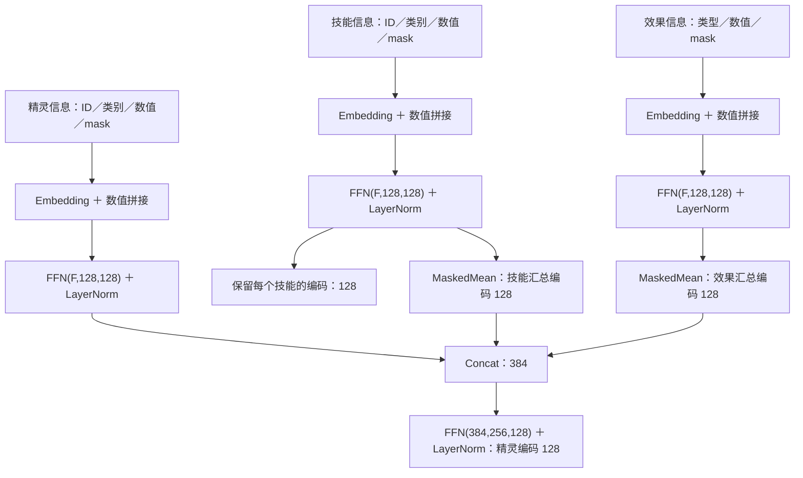
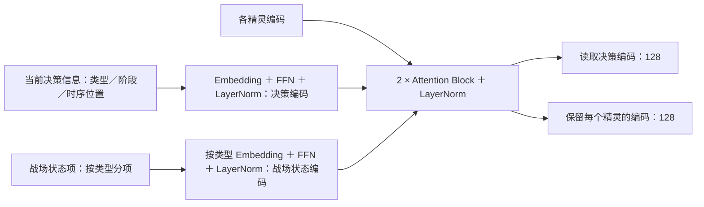
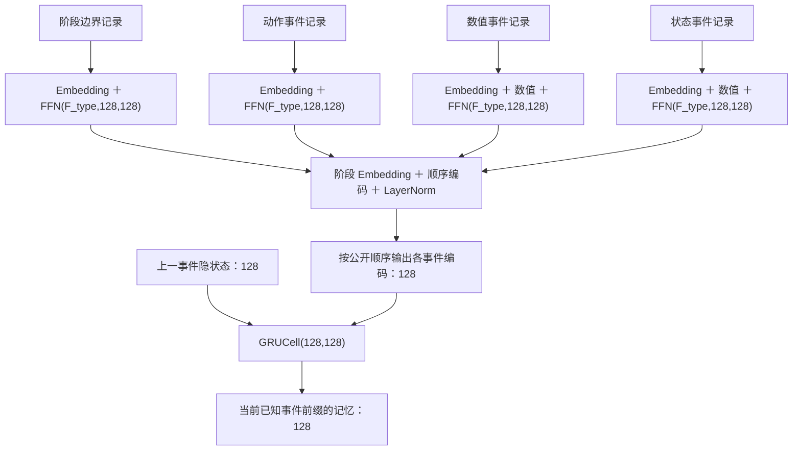
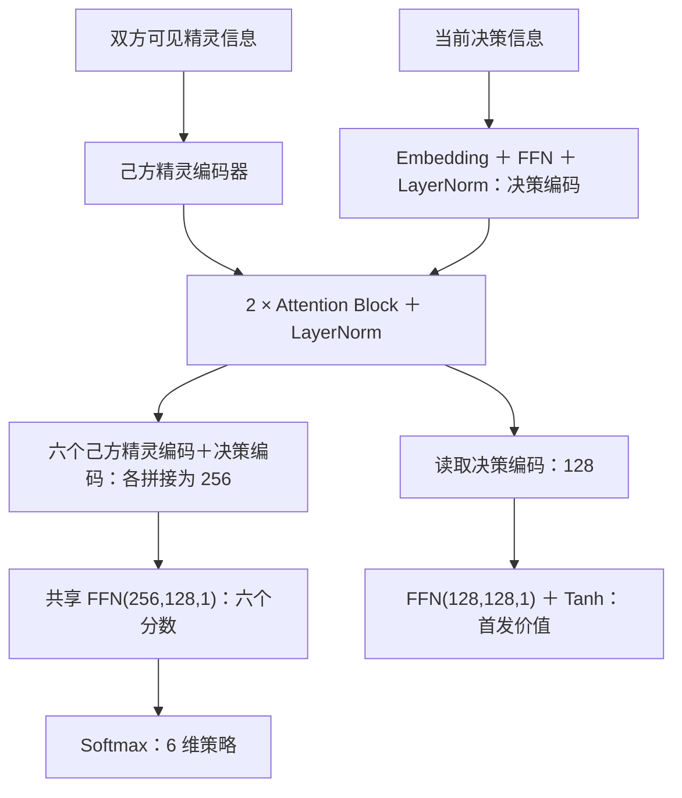
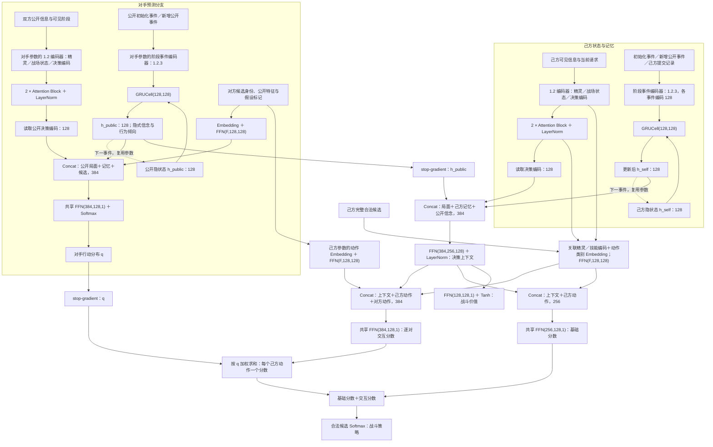
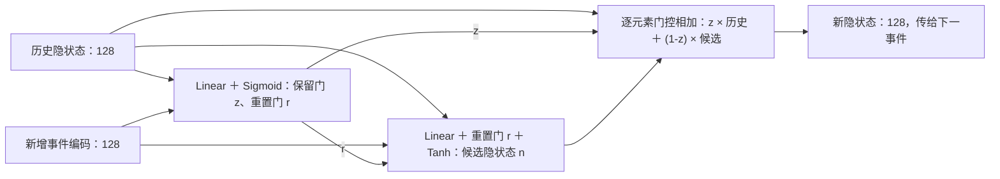

# Alpha Roco 模型设计

## 1. 网络结构

### 1.1 基本配置

#### 1.1.1 输入

- 可见特征、可见性掩码、有序事件及候选动作；数值归一化，未知值使用占位符。
- 对手预测分支仅接收公开信息。

#### 1.1.2 超参数

- 隐藏维度 `128`；Attention 为 `4` 头、`2` 层；两路记忆各使用单层 `GRU(128,128)`。
- 身份／类别 Embedding 为 `32／16` 维，阶段／顺序编码为 `128` 维。
- 训练超参数见第 3 节。

#### 1.1.3 可学习参数

- Embedding 表、Linear／Attention／GRU 的权重与偏置、LayerNorm 的缩放与偏移。
- 首发与战斗共享己方精灵编码器参数；对手分支参数独立。

#### 1.1.4 环境

- 设备：RTX 4080 SUPER（16 GB）。
- 时限：单次决策上限 `20` 秒。

### 1.2 输入信息与编码器

输入使用具体的信息名称；网络输出称为对应的编码向量，图中简写为“精灵编码：128”等，数字表示维度。

记号：`FFN(a,b,c) = Linear(a,b) → GELU → Linear(b,c)`；`F` 为输入维度；`MaskedMean` 对有效项求平均。

#### 1.2.1 精灵、技能与效果编码

#### 1.2.2 战场状态与决策编码

| 输入 | 编码内容 |
|---|---|
| 当前决策信息 `DECISION` | 决策类型、阶段、时序位置与参与方 |
| 精灵信息 | 身份、类别、数值、关联技能／效果与可见性掩码 |
| 战场状态项 | 状态类型、所属方、数值与可见性掩码；每项独立编码 |

- 各类型使用 `Embedding＋FFN(F_type,128,128)＋LayerNorm`；Attention 读取更新后的决策编码向量，并保留每个精灵的编码向量。

#### 1.2.3 阶段事件编码

- 事件记录：类型、阶段／实例／父阶段、关联动作、来源／目标、顺序、数值与可见性。
- 每条事件独立编码，包含阶段边界；同类事件跨阶段共享 FFN。
- 事件编码向量：`LayerNorm(FFN_type(事件字段编码)＋阶段 Embedding＋顺序编码)`，维度 `128`；按已知前缀送入 GRU。

### 1.3 Attention Block

首发、己方战斗局面、对手公开局面各使用 `2` 个下列 Block，输出接 LayerNorm；各分支分别设置 Block 参数。

### 1.4 首发模块

### 1.5 战斗模块

- 两路 GRU 分别编码己方可见历史和公共历史，后者形成隐式信念与行为倾向表示。
- 对手分支对候选动作输出概率；决策分支融合状态、记忆与信念，输出基础分数及按对手概率加权的动作交互分数。

### 1.6 时间连接

- 两路 GRU 独立参数、时间共享；隐状态按 episode 清零，按新增事件更新并去重，在决策点读取。
- $h_k=z_k\odot h_{k-1}+(1-z_k)\odot n_k$，$z_k$ 为保留门，$n_k$ 为候选隐状态。

## 2. 奖励

- 终局收益：获胜 `+1`，失败 `-1`，`both_lose` 对双方均为 `-1`；中间奖励为 `0`，$\gamma=1$。
- 首发与战斗共享收益，双方收益分别计算；真实终局停止自举，采样截断使用价值自举。

## 3. Loss 与更新

### 3.1 己方首发与战斗

分别计算 $k\in\{L,B\}$ 的 PPO 策略 loss：

$$
L_{\pi,k}=-\mathbb E\left[\min\left(\rho_k\hat A_k,\operatorname{clip}(\rho_k,1-\epsilon,1+\epsilon)\hat A_k\right)\right],\qquad
\rho_k=\frac{\pi_k(a\mid o,h)}{\pi_{k,\mathrm{old}}(a\mid o,h)}
$$

$$
L_{\mathrm{RL}}=\sum_{k\in\{L,B\}}\left(L_{\pi,k}+0.5\,\mathbb E[(V_k-\hat G_k)^2]-\beta_k\mathbb E[H(\pi_k)]\right)
$$

- 首发使用 $\hat G_L=z$、$\hat A_L=z-V_{L,\mathrm{old}}$；战斗使用 GAE，$\hat G_B=\hat A_B+V_{B,\mathrm{old}}$。
- 各阶段分别平均 loss、标准化策略优势；回报目标与价值目标保持原始尺度。
- 初始设置：$\epsilon=0.2$、GAE $\lambda=0.95$、$\beta_L=\beta_B=0.01$，Adam 学习率 `3e-4`，梯度范数上限 `0.5`。
- PPO 按有序对局重算己方循环状态；累计策略 KL 达 `0.02` 时结束该批策略更新。

### 3.2 对手预测

$$
L_{\mathrm{opp}}=-\mathbb E[\log q_\phi(a^{\mathrm{opp}}\mid I)]
$$

- $I$ 为决策前的公开信息历史，监督标签为对方实际提交行动；训练样本使用可确认标签。
- 交叉熵更新对手编码器、公开 GRU 与候选评分器，信念与习惯通过该目标学习。
- 对手分支使用独立 Adam，初始学习率 `3e-4`，梯度范数上限 `0.5`。

### 3.3 训练组织

- 首发与战斗共享己方编码器和对战轨迹，分别计算策略／价值 loss；对手分支按监督目标独立更新。
- 每批采样及对应 PPO 更新固定整条对手预测分支，包括 Embedding、局面编码与 GRU；预测更新安排在批次之间，换版后检查最终策略 KL。
- PPO 批内固定旧策略 log-prob、优势、回报目标与候选顺序；当前策略按事件前缀重算隐状态。
- 每批采样固定对战双方的策略版本；先预热战斗与预测分支，再联合更新首发。
- 记录固定对手集胜负、双方均失败比例与平均收益、价值误差、预测交叉熵、预测校准、PPO KL、裁剪比例和梯度范数。
